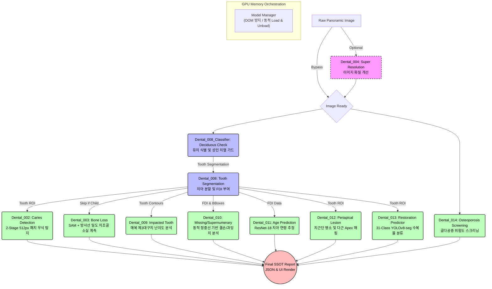

     

# Dental_Panoramic_Reader: Integrated Panoramic AI Diagnostic Gateway & Orchestrator (파노라마 통합 진단 파이프라인 및 게이트웨이)

## 개요

`Dental_Panoramic_Reader`는 파노라마 방사선 사진(Panoramic Radiograph)을 입력받아 화질 개선부터 치아 인스턴스 분할·FDI 치식 식별, 우식 탐지, 치근단 병소 탐지, 치조골 소실량 계측, 매복 사랑니 난이도 분석, 결손치 파악, 치아 연령 추정, 수복물 분류, 골다공증 위험도 스크리닝까지 아우르는 End-to-End 통합 진단 오케스트레이터 및 FastAPI 게이트웨이입니다.

- [학습 및 추론 하드웨어 사양]:
  - Development / Inference Env (랩탑 워크스테이션): Intel Core i5-14450HX, NVIDIA GeForce RTX 4060 Laptop GPU (8GB VRAM), 16GB RAM
  - Training Env (메인 워크스테이션): AMD Ryzen 9 9900X, NVIDIA GeForce RTX 5080 (16GB VRAM), 64GB RAM
- [E2E 추론 벤치마크 및 메모리 관리]:
  - Inference Latency: 파노라마 1장당 약 `2.5 seconds` (E2E 전체 파이프라인)
  - VRAM Peak: `core/model_manager.py`의 동적 모델 로드·언로드(Dynamic Load & Unload) 기법으로 8개 진단 모듈 구동 시 최대 `~6.5GB VRAM` 이하 유지

---

## 주요 기능 및 아키텍처

### 1. 핵심 파이프라인 데이터 흐름 (Architecture & Data Flow)

파이프라인은 Python 런타임 내장 참조(In-memory Submodule Call)와 FastAPI 게이트웨이(`api_server.py`)를 통해 최적화된 속도로 동작하며, `Dental_015` 임상 웹 대시보드에 SSOT JSON 리포트(SHA-256 해시 및 전처리 ID 바인딩 포함)를 제공합니다.



### 2. 각 서브모듈(Submodule)별 상세 역할 (`8/8 ONLINE`)
1. [`ModelManager` (`core/model_manager.py`)]: `Dental_Core`의 `get_device()` 및 `get_onnx_providers()`와 연동하여 VRAM 초과를 방지하기 위해 각 서브모듈 가중치를 추론 시점에만 동적으로 GPU에 로드하고 완료 즉시 언로드합니다.
2. [`Dental_004` (Super Resolution — 선택적 전처리)]: 저선량·저화질 파노라마 입력 시 `SwinIR-Lightweight` 타일링 복원으로 대비·노이즈를 개선합니다.
3. [`Dental_008` (Tooth Segmentation & Deciduous Classification — 코어)]:
   - `Classifier`: 유치(Deciduous) 포함 여부를 판별하며(BGR->RGB 정규화 및 `pos_weight=10.4` 로짓 보정 + 영구치 24개 이상/사랑니 존재 시 성인 치열 확정 가드), 소아 혼합치열일 경우 성인 치조골 기준이 적용되는 `Dental_003` 실행을 자동으로 건너뜁니다.
   - `Segmentation`: `YOLOv8m-seg`로 개별 치아 바운딩 박스와 마스크를 추출하고 2-Stage DP 시퀀스 매처로 FDI 번호(`11`~`48`)를 부여합니다.
4. [`Dental_002` (Caries Detection)]: 개별 치아 패치(`512x512`)를 크롭하여 우식 병소를 탐지하고 원본 치아 BBox 경계 내(5% 안전 마진)로 역투영합니다.
5. [`Dental_003` (Alveolar Bone Loss Measurement)]: `Dental_008` 치아 컨투어 및 `SAM ViT-B` 마스크와 전체 치아 마스크(`all_teeth_mask`) 배제 치간부 `CLAHE` 방사선 밀도 프로파일(`radiographic_densitometric_cej_crest_v2`)을 결합하여 치아별 RBL(%)·흡수량(mm)·AAP/EFP 병기(Stage I~IV) 및 해부학적 골소실 4점 폴리곤을 산출합니다.
6. [`Dental_012` (Periapical Lesion Detection)]: `YOLO11s` 음성 배경 증강 모델로 치근단 병소를 탐지하고 상·하악 다근치 치근단(Apex) 앵커점 기준으로 원인 FDI 치아를 매핑합니다.
7. [`Dental_013` (Restoration & Prosthesis Classification)]: 31-Class `YOLOv8-seg` ONNX 모델(`best_restoration_model.onnx`)을 통해 수복물을 검출하고 4대 임상 범주(`Crown/Bridge`, `Implant`, `Inlay/Onlay`, `Endodontic (RCT)`) 및 FDI 치아 번호에 매핑합니다.
8. [`Dental_009` (Impacted Third Molar Analysis)]: 제3대구치와 인접 제2대구치 컨투어 PCA 장축 각도(Winter's Classification) 및 맹출 깊이(Pell & Gregory Level A/B/C)를 분석합니다.
9. [`Dental_010` (Missing & Supernumerary Tooth Detection)]: 최소 치아 수 가드(`< 8`), 동적 정중선 추정, 인접치 갭 비율 휴리스틱(`gap_ratio >= 1.55`)으로 결손치를 판별합니다.
10. [`Dental_011` (Dental Age Estimation)]: `ResNet-18` 하이브리드 회귀 모델로 치아 연령을 추정합니다.
11. [`Dental_014` (Osteoporosis Screening)]: `OsteoMAENet`(`best.pt`)과 하악 피질골 형태학적 특징(`morphology_features`) 융합을 통해 골다공증 위험도(`C1/C2/C3`)를 스크리닝합니다.

---

## 벤치마크 및 검증 성능

- 게이트웨이 헬스체크(`GET /api/v1/health`): 8개 핵심 진단 모듈(`008, 002, 012, 010, 003, 009, 013, 014`) 전원 `ONLINE` (`8/8 ACTIVE`) 검증 완료.
- 중앙 통합 테스트 스위트(`Dental_000/tests/tests_panoramic_reader`): 파이프라인 초기화, FDI 매핑, 유치 우회 분기, 가중치 매니페스트 및 API 보안 하드닝, 저장소 위생 테스트 전원 통과.

---

## 데이터셋 출처 및 라이선스

본 프로젝트의 각 서브모듈 학습 및 검증에 사용된 주요 데이터셋 출처는 다음과 같습니다(원본 제한 데이터셋은 저장소에 재배포하지 않습니다):
1. [DENTEX Challenge 2023 (`CC BY-NC-SA 4.0`)]: `Dental_008` (치아 분할 및 FDI), `Dental_002` (우식 패치 탐지), `sample_panorama.png`.
2. [Mendeley Periapical Lesions Dataset (`DOI: 10.17632/kx52tk2ddj.3`, `CC BY 4.0`)]: `Dental_012` (치근단 병소 탐지).
3. [Zenodo Panoramic Radiography Datasets (`4457648` & `16745408`, `CC BY 4.0`)]: `Dental_003` (치조골 소실) 및 `Dental_011` (치아 연령 추정).
4. [Kaggle Dental Disease Panoramic Detection (`lokisilvres`)]: `Dental_013` (수복물 분할).
5. [BRAR-anchored Multimodal Dataset (Restricted Academic Cohort)]: `Dental_014` (`OsteoMAENet` 골다공증 스크리닝; 기존 `Sharda Dataset`은 환자 식별자 손실 및 데이터 누수 문제로 배제됨).
6. [소스 코드 라이선스]: 본 저장소의 소스 코드는 `MIT License` ([LICENSE](LICENSE), `Copyright (c) 2026 Hyunchan An`) 하에 배포됩니다.

---

## 설치 및 실행 방법

### 1. 소스코드 클론 및 가중치 세팅
```bash
git clone --recursive https://github.com/HyunchanAn/Dental_Panoramic_Reader.git
cd Dental_Panoramic_Reader
pip install -r requirements.txt
python setup_env.py
```

### 2. 애플리케이션 실행 (FastAPI 게이트웨이 및 Streamlit 워크벤치)
```bash
# FastAPI Gateway (Dental_015 프론트엔드 연동, 기본 바인딩 127.0.0.1:8000)
uvicorn api_server:app --host 127.0.0.1 --port 8000

# Streamlit 통합 워크벤치 (로컬 127.0.0.1 바인딩 래퍼 또는 전용 포트 8500)
python run.py
# 또는
streamlit run app.py --server.port 8500
```

### 3. 중앙집중식 통합 테스트 실행
```bash
pytest ../Dental_000/tests/tests_panoramic_reader -v
```

---

## 참고 문헌 및 연구용 실행 주의사항

- 전체 시리즈 라이선스 및 데이터셋 출처 매트릭스: `Dental_000/reports/261020_0205_Dental_Series_License_and_Data_Provenance_Matrix.md`
- [연구용 실행 주의사항]:
  - 기본 실행 주소: `127.0.0.1` (로컬 전용)
  - 외부 공개/상용 배포 금지 및 오픈 데이터셋 외 민감 의료데이터 사용 금지
  - API 키·토큰은 환경변수로만 관리하며, 외부 접근이 필요하면 `ALLOW_EXTERNAL_ACCESS=true`로만 명시적 허용
